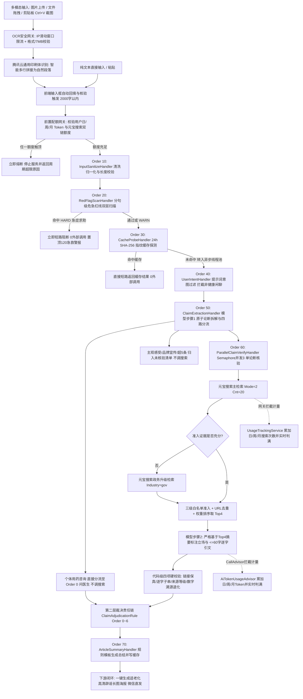

# 【元宝搜索开发者征文】专治“相亲相爱一家人”群养生谣言！我用腾讯元宝搜索 + Spring AI 做了个不讲胡话的健康谣言核验系统

> **一句话介绍**：「家医智核·流言粉碎」（FamilyDoc Sentinel）是一个面向中老年人及其子女的健康谣言核验系统。系统深度整合**腾讯云通用印刷体识别（OCR）与腾讯云元宝搜索（WSA `SearchPro`）**，支持家族群**大字长辈图/微信截图一键上传、拖拽与 `Ctrl+V` 剪贴板直贴**识图提取；基于**双层责任链架构**在运行时检索卫健委、疾控、药监、三甲医院等权威来源，通过**多级提示词过滤与代码级四项硬校验**把大模型严格限制在“拆说法、读证据、摘原话”的安全边界内，结论由**确定性规则引擎**裁决并可**一键生成适老化辟谣长图**直接回传微信群。同时，系统内置基于 Spring AI `CallAdvisor` 与搜索网关的**双链三周期（日/周/月）Token 与元宝搜索额度熔断机制**，实现从视觉识图输入、权威循证、防幻觉裁决到社交传播与成本管控的完整闭环。

| 项目信息 | 内容 |
| :-- | :-- |
| **作品状态** | **已上线**（支持多用户在线注册体验、多模态识图输入、双链配额实时管控、辟谣长图生成与云端核验历史） |
| **开源仓库** | [https://github.com/yjiace/familydoc-sentinel](https://github.com/yjiace/familydoc-sentinel) |
| **多模态能力** | 腾讯云通用印刷体识别 OCR（`tencentcloud-sdk-java-ocr` 3.2.42，共享腾讯云 API 密钥体系，支持剪贴板 `Ctrl+V` 截图粘贴、文件拖拽、图片上传与自然段落智能重组） |
| **搜索能力** | 腾讯云元宝搜索 WSA `SearchPro`（`tencentcloud-sdk-java-wsa` 3.2.42，混合模式 `Mode=2` + 政务行业 `Industry=gov` 渐进式升级检索） |
| **AI 与后端** | JDK 21、Spring Boot 4.1.2、Spring AI 2.0.2（DeepSeek-Chat，`temperature=0.0`）、双层责任链模式、PostgreSQL、Redis、Caffeine |
| **前端与交互** | Vue 3 + Vite + TypeScript，适老化大字号、五色双层印章卡片、全量适老化辟谣长图一键生成与剪贴板复制、双链三周期额度实时看板 |
| **关键词** | 元宝搜索、腾讯云 WSA、腾讯云 OCR、SearchPro、Spring AI、多模态输入、长图分享、RAG 防幻觉、双层责任链、提示词过滤、CallAdvisor、双链额度熔断 |


*▲ 图：家医智核主界面运行实况——左栏粘贴家族群长文并实时监控日/周/月双链额度（Token + 元宝搜索次数），右栏输出危急红线提醒、整篇总结、五色适老化印章卡片、元宝搜索权威出处摘录与未核验清单*

---

## 一、需求从哪里来：家族群养生谣言、大模型幻觉与调用成本控制

“*多吃大蒜能彻底预防脑梗*”“*降压药伤肝肾，喝醋才是天然降压药*”“*突发心梗别打 120，用力拍打手肘内侧就能急救*”——面对家庭微信群里高频转发的千字养生文，现有查证方式存在三个痛点：

1. **普通搜索噪音大，长文多论点难拆解**：常规网页搜索混杂大量自媒体、保健品软文与广告，中老年长辈难以分辨；一篇群转发长文往往夹杂三四条真假参半的说法，手动逐条查证门槛极高。
2. **中老年养生信息高度“视觉化”，纯文本输入存在天然鸿沟**：在家庭微信群中，流传最多的并非规范排版的纯文本，而是花哨的**“大字长辈图”、朋友圈长图、文章截图甚至短视频定格海报**。中老年人习惯直接转发图片，晚辈要想核实，过去必须手动逐字敲入或使用第三方识别工具二次中转，繁琐的操作步骤直接劝退了大部分查证意愿；
3. **通用大模型容易“一本正经编造医学结论”**：大模型参数记忆存在滞后，面对缺乏证据的偏方倾向于强行下定论或伪造链接；更危险的是，它可能对具体患者越界给出“该吃几片、能否停药”的个体化用药指导。
4. **面向 ToC 用户的零配置体验与平台密钥成本管控矛盾**：许多开源 AI 工具要求用户自行注册云厂商账号、申请并填写 API Key（BYOK 模式），这对中老年长辈和普通家庭用户而言门槛过高。本项目面向 ToC 用户采用**平台统一托管元宝搜索密钥、OCR 密钥与大模型密钥**的模式，屏蔽一切繁琐配置，让用户只关心“图片/文本一键输入、查看核验输出与一键分享辟谣”；但由平台统一承担调用成本后，若缺乏细粒度的资源计量、限流与配额熔断机制，单一高频用户或异常脚本即可迅速耗尽平台预算。

---

## 二、为什么需要元宝搜索：用实时权威证据压制模型幻觉

* **大模型缺少的外部信息**：国家及省市卫健委、疾控中心、药监局、世界卫生组织、三甲医院及权威科普平台发布的**真实网页摘要、可点击核查的原始 URL 与发布日期**。
* **在哪个环节调用**：元宝搜索在**应用运行时（Runtime）被实时调用**。系统先将用户长文拆解为独立的“原子论断”并过滤掉无关信息，再为每条可核验论断生成**无倾向的中性检索词**调用 `SearchPro`，召回结果经三级白名单准入后才交由模型摘录。
* **为什么选择腾讯元宝搜索 `SearchPro`**：
  1. `Mode=2` 混合模式同时覆盖自然检索结果与权威 VR 结构化结果，中文医疗健康网页召回率高；
  2. `Industry="gov"` 行业过滤支持定向检索政务与官方机构站点，当首次混合检索的一级权威证据不足时，追加一次政务检索即可精准补齐；
  3. 返回字段自带标题、URL、站点名称、摘要、发布日期与相关度打分（`Score`），天然契合“三级白名单加权排序、逐字引文比对、链接保真校验”的防幻觉流水线。
* **与腾讯云通用 OCR 的双擎协同体系**：
  在实际落地中，腾讯云通用印刷体识别（OCR）与元宝搜索（WSA）形成了极佳的互补搭档——**OCR 专注于“感知层”的高精度视觉转文字**，攻克大字长辈图与微信截图中低分辨率、复杂艺术字体及生僻医学名词的识别瓶颈；**元宝搜索则专注于“认知层”的权威事实循证**，提供可信赖的官方证据底座。两者共享统一的腾讯云云 API 鉴权基础设施，构筑起从图像输入到深度循证的坚实壁垒。

---

## 三、核心架构实现：双层责任链、元宝搜索、提示词过滤与双链额度熔断

### 3.1 总体架构：双层责任链驱动的 AI 核验流水线

系统拒绝“一段大 Prompt 让模型包办一切”的黑盒做法，而是设计了**“第一层主流程编排责任链（Order 10~70） + 第二层单论断确定性裁决责任链（Order 0~6）”**的双层架构，并在入口与底层调用处嵌入双链额度熔断器：



**第一层主流程责任链（`FactCheckPipelineHandler`）节点职责**：
前三个节点在 HTTP 线程同步执行，确保危急求救与重复请求在 **0 外部 API 消耗**下毫秒级短路返回；后四个节点在 `factCheckTaskExecutor` 异步线程池中推进，每个节点执行前均复核用户双链额度：

| 顺序 | 处理器类 | 执行方式 | 核心职责与过滤机制 |
| :--: | :-- | :--: | :-- |
| `@Order(10)` | `InputSanitizeHandler` | 同步前置 | Unicode NFKC 归一化，正则剥离“转发自 / 家人们必看”等微信群噪音，校验有效字符数 |
| `@Order(20)` | `RedFlagScanHandler` | 同步前置 | 分句级生理指标阈值 + 急症词 + 第一/二人称 + 现时求助词共现扫描（带 8 字符否定前瞻），`HARD` 级立即短路拦截 |
| `@Order(30)` | `CacheProbeHandler` | 同步前置 | 计算归一化文本 SHA-256 指纹，命中 24h 缓存且未指定 `skipCache` 时直接返回，省去全部搜索与模型调用 |
| `@Order(40)` | `UserIntentHandler` | 异步核验 | 快速提示词意图分类，若全文均为写代码、闲聊或纯商业广告，直接终止管道，不消耗元宝搜索次数 |
| `@Order(50)` | `ClaimExtractionHandler` | 异步核验 | 模型步骤 1：拆解原子论断、四路分流（拦截个体用药与商品宣传）、风险分级（保留 Top 5）、生成中性检索词 |
| `@Order(60)` | `ParallelClaimVerifyHandler` | 异步核验 | `Semaphore(3)` 控制最多 3 条论断并发：执行元宝搜索两阶段检索 → 三级白名单准入 → 模型步骤 2 摘录 → 第二层裁决链 |
| `@Order(70)` | `ArticleSummaryHandler` | 异步核验 | 纯确定性规则模板汇总各卡片结论生成整篇导语，写入 24h 缓存并落库云端核验快照 |

---

### 3.2 元宝搜索深度接入：中性检索词、渐进式升级与三级白名单

#### （1）SDK 接入与请求组装
通过腾讯云官方 `tencentcloud-sdk-java-wsa` 接入，密钥由环境变量注入，连接与读写超时统一设为 3 秒。单次检索请求组装如下：

```java
SearchProRequest req = new SearchProRequest();
req.setQuery(query);      // 经过禁用词剥离与长度控制的中性检索词
req.setMode(2L);          // 混合模式：自然检索结果 + 权威 VR 结果
req.setCnt(20L);          // 每次召回 20 条候选网页
if (industry != null) {
    req.setIndustry(industry);  // 升级检索时传入 "gov" 定向召回政务来源
}
// 不传 Freshness 时效参数，避免过滤掉卫健委、疾控中心长期有效的权威科普指南
SearchProResponse res = wsaClient.SearchPro(req);
```

#### （2）中性检索词设计：从源头规避“确认偏见”
如果直接拿“*喝醋软化血管是真的吗*”或“*喝醋 辟谣*”去调用搜索，召回结果会严重偏向单一立场。系统在 `ClaimExtractionService` 中对检索词施加三道约束：
1. **固定中性句式**：强制生成 `核心主谓宾 + 是否有效 / 有无科学依据 / 医学研究` 格式；
2. **12 个倾向词与机构名代码级强制剥离**：Prompt 约束之外，`TextSanitizer.stripForbiddenQueryWords()` 强制剥离 `辟谣、谣言、骗局、假消息、流言、真相`（防立场偏见）以及 `卫健委、疾控中心、世卫组织、丁香医生、人民网、央视`（防召回结果被单一站点垄断）；
3. **超长语义压缩（绝不物理截断）**：检索词超过 50 字上限时，触发模型语义压缩重写（最多 2 次）；仍超长则归入未核验清单，严禁使用 `substring` 截出残缺语义去调用元宝搜索。

```text
原流言文本：别再被西药骗了，每天喝老陈醋一个月软化血管治好高血压！
错误检索词：喝老陈醋治疗高血压 辟谣 真相      （带强烈倾向，召回结果被污染）
中性检索词：喝醋软化血管降血压有无科学依据
```

#### （3）两阶段渐进式检索与三级白名单准入
每条可核验论断在 `WsaSearchService` 中按“先混合、不够再升政务”的两阶段策略执行，既保证权威覆盖率，又把单论断平均搜索次数压在 **1.5 次以内**：

```java
// 阶段 1：元宝搜索主检索（Mode=2, Cnt=20）
SingleCallResult primaryResult = executeWithRetryIfEligible(neutralQuery, null, ...);
accumulatedPages.addAll(primaryResult.pages());

List<EvidenceItemDto> admitted = evidenceAdmissionService.admitAndRank(accumulatedPages);
// 充分性判定：至少 1 条一级来源(相关度>=0.5)，或至少 2 条不同主域名的二级来源(相关度>=0.5)
if (evidenceAdmissionService.isEvidenceSufficient(admitted)) {
    return new ClaimSearchOutcome(admitted, claimCallsUsed.get(), false, null); // 证据充分，立即停止检索
}
// 阶段 2：证据不足且预算允许时，追加 Industry="gov" 政务升级检索
if (canInvokeNextSearch(claimCallsUsed.get(), maxPerClaim, requestBudgetUsed.get())) {
    notifyStage(stageStatusCallback, ClaimVerifyStage.UPGRADE_SEARCHING);
    SingleCallResult govResult = executeWithRetryIfEligible(neutralQuery, "gov", ...);
    if (govResult.success() && !govResult.pages().isEmpty()) {
        accumulatedPages.addAll(govResult.pages());
        admitted = evidenceAdmissionService.admitAndRank(accumulatedPages);
    }
}
```

召回的原始网页须通过 `EvidenceAdmissionService` 的**三级白名单过滤**（注意：通过 `Industry="gov"` 召回的页面不自动算作一级来源，仍须校验域名或机构关键词）：
* **一级来源（权重 1.5）**：国家及省市卫健委、疾控中心、药监局、WHO、中华医学会等官方域名，或 `.gov.cn/.org.cn/.edu.cn/.ac.cn/.int` 后缀且站点名命中权威卫生机构关键词；
* **二级来源（权重 1.2）**：三甲医院与重点医学院校官网、主流官媒健康频道（前端显式标注“媒体报道”）、白名单内的专业医学科普平台（科普中国、腾讯医典、丁香医生、中国医药信息查询平台、默沙东诊疗手册等）；
* **零级来源（直接丢弃）**：自媒体、商业营销号、保健品软文等未命中白名单的站点，**一律剔除，不进入大模型上下文，也不在前端展示**。

准入候选先做 URL 规范化（剥离 `utm_*`、`spm` 等参数）与同站同标题去重，再按 $\text{Score} = \text{Relevance} \times \text{TierWeight}$ 降序取 **Top 4**，摘要按句子边界截取至 800 字以内送入模型。

---

### 3.3 提示词过滤、代码级四项硬校验与第二层裁决责任链

为了彻底杜绝大模型自由发挥，系统将模型温度固定为 `0.0`，先对用户输入转义尖括号并包裹在 `<user_article>` 标签内防提示词注入，再通过“两步提示词 + 四项代码硬校验 + 七级确定性规则链”收束输出。

#### （1）两步提示词过滤设计
* **步骤 1（拆解与四路分流，不判真假）**：提取原子论断并标注类别（`DRUG` / `DISEASE` / `LIFESTYLE`）、风险等级（`HIGH` / `MEDIUM` / `LOW`）及是否属于个体用药咨询（`personalMedication`）。具名品牌宣传、主观感受、笼统口号直接分流至 `unverifiedItems`；可核验论断超出 5 条时按 `HIGH > MEDIUM > LOW` 优先级保留前 5 条。
* **步骤 2（严格基于 Top 4 证据摘录原话）**：模型只能依据元宝搜索准入的 Top 4 证据摘要，标注五类立场之一（`SUPPORT` / `REFUTE` / `CONDITIONAL` / `INSUFFICIENT` / `IRRELEVANT`），并提取原句：

```markdown
你【严禁】使用外部知识，只能严格依据输入的候选证据摘要，对目标论断逐条标注立场并摘录原文。
- quote 长度必须严格 <= 60 个字符，不得改写、不得省略号拼接、不得编造，必须是来源摘要的连续子串；
- 说明文字只能转述本次已摘录的 quote 内容，严禁引入摘要之外的任何新医学结论或用药建议；
- 说明文字中如果出现任何数字，该数字必须已经在你摘录的 quote 中出现过；
- 严禁使用“权威”“100%正确”“绝对属实”“名医背书”等词汇，统一使用“可信来源”“查证来源”。
```

#### （2）代码级四项硬校验与“数字溯源安全退化”
Prompt 约束不能替代代码校验。`StanceAnnotationService` 对模型返回的每条立场执行四道硬校验，任一项不通过直接作废该条立场：

```java
// 校验 1：链接保真 —— URL 必须出现在本次元宝搜索真实返回且已准入的 Top4 集合中（防编造链接）
EvidenceItemDto matchedSource = urlToEvidenceMap.get(returnedUrl);
if (matchedSource == null) { continue; }

// 校验 2：逐字引文 —— 忽略空白符差异后，quote 非空、<= 60 字，且必须是来源摘要的连续子串（防篡改原话）
if (!isQuoteVerbatimValid(quote, matchedSource.getSourceSummary())) { continue; }

// 校验 3：来源等级 —— 被引来源必须是 TIER_1 或 TIER_2
if (!isTierAdmitted(matchedSource.getTierCode())) { continue; }

// 校验 4：禁用词替换 + 数字溯源校验（若说明文字出现引文之外的数字，立即触发安全退化）
String sanitizedExplanation = sanitizeAndValidateExplanation(rawExplanation, combinedQuotes, passedList);
```

**数字溯源安全退化机制**：代码通过正则 `\d+(?:\.\d+)?` 提取模型说明文字中的所有数字，逐一比对是否出现在已摘录的 `quote` 原文中。一旦发现模型自行脑补了统计数字（例如引文只写“多数患者”，模型却写出“80%的患者”），立即丢弃模型生成的说明，强制退化为 `查证来源（机构名）摘录指出：“原文引文”` 的纯引文安全模板。

#### （3）第二层裁决责任链（`ClaimAdjudicationRule` Order 0~6）
通过硬校验的证据立场交由 `ClaimAdjudicationEngine`，按 `@Order(0)` 至 `@Order(6)` 顺序执行确定性规则裁决，命中即终止：

| 顺序 | 规则类 | 触发条件 | 裁决结论与处理策略 |
| :--: | :-- | :-- | :-- |
| `0` | `PersonalMedicationRule` | `personalMedication = true`（个体用药咨询） | **问医生 · 需遵医嘱**（不发起元宝搜索，直接阻断剂量建议） |
| `1` | `RuntimeExceptionRetryRule` | 检索或模型调用超时 / 异常 | **待重试 · 核验中断**（不出印章、不写缓存，支持前端单条重试） |
| `2` | `EmptyOrInsufficientStanceRule` | 有效立场为空，或仅含 `INSUFFICIENT` | **没查实**（细分标注：证据不足 / 目前缺乏证据 / 引用未通过校验） |
| `3` | `ConflictResolutionRule` | 否定立场与支持/条件立场同时存在 | 仅一方含一级来源时以一级来源为准并附注“口径不同”；否则判 **没查实 · 来源冲突** 并双栏并列展示 |
| `4` | `RefuteOnlyRule` | 仅有否定（`REFUTE`）立场 | 满足定论强度判 **有误导 · 与依据矛盾**；否则降级为 **没查实 · 证据偏弱** |
| `5` | `ConditionalRule` | 无否定、含条件成立（`CONDITIONAL`） | 满足定论强度判 **看情况 · 因人而异**；否则降级为 **没查实 · 证据偏弱** |
| `6` | `SupportOnlyRule` | 仅有支持（`SUPPORT`）立场 | 满足定论强度判 **有依据 · 说法可信**；否则降级为 **没查实 · 证据偏弱** |

> **定论强度硬门槛**：同向有效来源中必须**至少含 1 条一级来源**，或**来自至少 2 个不同主域名的二级来源**；仅靠单条二级来源孤证绝不下“有依据 / 有误导”定论，一律降级为“没查实 · 证据偏弱”。所有药物类（`DRUG`）卡片底部强制附加“请勿自行停药、换药或加减剂量”安全警示。


*▲ 图：第二层裁决责任链（Order 0~6）产出的各状态卡片（有依据、看情况、来源冲突双栏、问医生、待重试）*


*▲ 图：`VerdictStamp` 组件的五色适老化双层印章（形状 + 色彩 + 口语大字 + 严谨小字双编码）*


*▲ 图：第一层责任链 `@Order(20) RedFlagScanHandler` 的 `HARD` 拦截态（0 外部调用，一键拨打 120）与 `WARN` 提示态对比*

---

### 3.4 Token 统计、元宝搜索计量与双链三周期额度熔断架构

由于系统面向 ToC 用户提供开箱即用的体验，**元宝搜索密钥与大模型密钥均由平台服务端统一托管**，用户无需关心任何底层密钥申请与参数配置。为保障平台公共密钥池在多用户开放试用下不被刷穿，系统在轻量级账号鉴权之上，设计了一套**无侵入双轨计量与日/周/月三级短板熔断架构**。

#### （1）五道调用预算闸门
系统从单论断、单次任务、单用户三周期到系统全局设置了五层硬约束：

| 预算层级 | 控制维度 | 硬性阈值与熔断规则 |
| :-- | :-- | :-- |
| **1. 用户双链三周期配额** | **Token 链 + 元宝搜索链（日/周/月）** | **Token 默认上限**：每日 `50,000` / 每周 `200,000` / 每月 `500,000`<br>**元宝搜索默认上限**：每日 `30 次` / 每周 `120 次` / 每月 `300 次`<br>支持在 `sys_user_usage_stat` 按单用户独立覆盖上限；**两条链路、三个周期中任一指标达上限，立即熔断并停止该用户核验服务** |
| **2. 单条论断检索预算** | 元宝搜索调用次数 / 超时 | 单论断最多 **3 次**（含重试），设计目标平均 ≤ 1.5 次；单论断总时限 12 秒 |
| **3. 单次任务检索预算** | 元宝搜索调用次数 / 并发 | 单次任务最多拆解 5 条论断、总搜索上限 **12 次**；`Semaphore(3)` 限制并发，整次任务时限 30 秒 |
| **4. 异常重试约束** | 网络超时或 5xx 重试 | 仅超时或 5xx 时重试 1 次，且严格计入单论断 3 次与单任务 12 次预算内 |
| **5. 系统全局日额度** | 全站每日元宝搜索总次数 | 默认 **5,000 次/天**，达 80% 输出 `[QuotaAlert]` 告警日志，耗尽后全局阻断外部调用 |

#### （2）跨异步线程的上下文透传与无侵入双轨拦截
核验流程跨越了“HTTP 接收线程 → `factCheckTaskExecutor` 主管道线程 → `claimVerifyExecutor` 论断并发线程”三层线程。常规基于 `ThreadLocal` 的 `UserContext` 在异步线程中会丢失，导致 Token 和搜索次数无法归属到具体用户。为此系统通过 `TaskExecutionHolder` 在每次线程切换入口显式挂载 `(userId, taskId)` 并在 `finally` 中清理，配合两处底层拦截器实现 **100% 调用入账**：

* **大模型 Token 拦截计量（Spring AI `CallAdvisor`）**：实现 `AiTokenUsageAdvisor` 挂载至 `ChatClient`，无需修改任何业务 Prompt 调用代码。每次调用前先执行 `checkUserQuotaAvailable(userId)` 预检配额；调用完成后自动从响应元数据提取 `promptTokens` 与 `completionTokens`，同步累加至当前任务与用户的日/周/月/总 Token 计数器。
* **元宝搜索网关级计量（`WsaSearchService`）**：在 `wsaClient.SearchPro(req)` 调用前执行配额校验，在 `finally` 块中记录单次搜索耗时与调用次数，写入 `sys_usage_log` 审计流水并更新用户日/周/月/总搜索计数。

```java
// AiTokenUsageAdvisor.java —— Spring AI CallAdvisor 无侵入拦截预检与 Token 计量
@Override
public ChatClientResponse adviseCall(ChatClientRequest request, CallAdvisorChain chain) {
    Long userId = TaskExecutionHolder.getUserId() != null ? TaskExecutionHolder.getUserId() : UserContext.getUserId();
    if (userId != null) {
        usageTrackingService.checkUserQuotaAvailable(userId); // 调用前实时校验日/周/月双链额度，满额直接抛 BizException 熔断
    }
    long start = System.currentTimeMillis();
    ChatClientResponse clientResponse = chain.nextCall(request);
    long cost = System.currentTimeMillis() - start;
    Usage usage = clientResponse.chatResponse().getMetadata().getUsage();
    usageTrackingService.recordModelUsage(userId, TaskExecutionHolder.getTaskId(),
            "DEEPSEEK_CHAT", usage.getPromptTokens(), usage.getCompletionTokens(), cost);
    taskStateManager.recordTaskTokens(TaskExecutionHolder.getTaskId(), usage.getTotalTokens());
    return clientResponse;
}
```

#### （3）日/周/月周期游标惰性对齐与双链短板熔断算法
系统无需依赖外部定时任务跑批清零，而是在 `UsageTrackingService` 中维护三个周期基准日游标：`dailyPeriodDate`（自然日）、`weeklyPeriodDate`（ISO 自然周周一）、`monthlyPeriodDate`（自然月 1 日）。每次读取或扣减额度时自动执行惰性对齐与短板检查：

```java
// UsageTrackingService.java —— 跨周期惰性自动归零与双链短板熔断判定
private String evaluateQuotaExhaustionReason(UserUsageStatEntity stat) {
    FactCheckProperties.UserQuota defaultQuota = getDefaultQuota();
    // 按 每日 -> 每周 -> 每月 顺序，依次校验 Token 链与元宝搜索次数链（短板效应：哪个先满即刻停止服务）
    if (safeLong(stat.getDailyTokens()) >= resolveLimit(stat.getDailyTokenLimit(), defaultQuota.getDailyTokenLimit())) {
        return String.format("今日 Token 额度已用完（%d / %d），已停止服务，请明日再试", ...);
    }
    if (safeLong(stat.getDailySearchCount()) >= resolveLimit(stat.getDailySearchLimit(), defaultQuota.getDailySearchLimit())) {
        return String.format("今日元宝搜索次数额度已用完（%d / %d 次），已停止服务，请明日再试", ...);
    }
    // 同理依次检查本周 Token、本周元宝搜索、本月 Token、本月元宝搜索...
    return null;
}
```

这套熔断检查同时部署在**三个切面**：① 任务提交与单条重试入口（前置拦截）；② 异步责任链每个 Handler 节点推进前与并发论断启动前（中途熔断，防止单个大任务持续透支）；③ `AiTokenUsageAdvisor` 与 `WsaSearchService` 每次底层调用前（原子级拦截）。


*▲ 图：前端 `HeroBanner` 与左栏 `InputPanel` 的双链三周期（今日/本周/本月）Token 与元宝搜索额度实时看板，以及任一维度触顶后的红色熔断停止服务状态（对应建议截图 7）*


*▲ 图：云端核验历史抽屉 `LocalHistoryDrawer`，每条核验快照均精确记录本次消耗的 Token 数与元宝搜索调用次数（对应建议截图 8；登录注册弹窗见建议截图 6 `https://cdn.smallyoung.cn/1/6.png`）*

---

### 3.5 多模态输入闭环：腾讯云通用 OCR 视觉识别、智能段落拼接与防滥用限流

在中老年社交场景中，流传最多的谣言往往并非规范排版的纯文本，而是花哨的**“大字长辈图”、微信推文截图甚至短视频定格海报**。中老年人习惯直接转发图片，如果强制用户先逐字手打或使用第三方工具提取文本，会造成巨大的使用门槛。为此，系统深度集成**腾讯云通用印刷体识别（GeneralBasicOCR）**，构筑了开箱即用的多模态输入闭环。

#### （1）SDK 统一鉴权与基础设施复用
OCR 模块直接引入官方最新 `tencentcloud-sdk-java-ocr:3.2.42`，与元宝搜索（WSA）SDK 保持同一版本体系。由于同属于腾讯云云 API 生态，后端通过 `OcrClientConfig` 复用完全相同的 `SecretId`、`SecretKey` 与地域配置（`ap-guangzhou`），无需在平台额外维护第二套密钥或引入第三方臃肿的 Python 识图服务：

```java
// OcrClientConfig.java —— 共享腾讯云官方凭证客户端注入
@Configuration
public class OcrClientConfig {
    @Bean
    public OcrClient ocrClient(FactCheckProperties properties) {
        Credential cred = new Credential(
                properties.getTencentCloud().getSecretId(),
                properties.getTencentCloud().getSecretKey()
        );
        ClientProfile clientProfile = new ClientProfile();
        clientProfile.setHttpProfile(new HttpProfile());
        return new OcrClient(cred, properties.getTencentCloud().getRegion(), clientProfile);
    }
}
```

#### （2）前端多模态交互：支持剪贴板 `Ctrl+V` 截图直贴与拖拽
针对中老年群聊场景的交互特征，前端 `InputPanel.vue` 实现了三种便捷输入方式：
1. **工具栏识图按钮**：点击唤起原生文件选择框（支持 JPG、PNG、WEBP 等主流格式）；
2. **剪贴板截图直贴（`Ctrl+V`）**：用户在微信电脑端、微信网页版或浏览器中右键“复制图片/截图”后，回到家医智核界面直接按 `Ctrl+V`，页面全局事件监听器捕获 `ClipboardItem` 自动转为 Base64 发起识别，无需中转保存到本地；
3. **文件拖拽（Drag-and-Drop）**：直接将图片拖入输入文本域，即刻触发解析。

```typescript
// InputPanel.vue —— 剪贴板 Ctrl+V 截图直接识别
function handlePaste(event: ClipboardEvent) {
  const items = event.clipboardData?.items
  if (!items) return
  for (const item of items) {
    if (item.type.startsWith('image/')) {
      const file = item.getAsFile()
      if (file) {
        event.preventDefault()
        processImageFile(file) // 校验体积并转 Base64 提交腾讯云 OCR 接口
        break
      }
    }
  }
}
```

#### （3）智能段落重组算法与 SDK 异常安全转译
腾讯云通用印刷体识别（`GeneralBasicOCR`）返回的是包含坐标信息的离散文本块集合。如果粗暴地按行换行拼接，会导致语义断裂，破坏后续 `@Order(20)` 分句级危急红线扫描与 `@Order(50)` 原子论断拆解的准确性。`OcrService` 实现了基于中文标点与换行特性的**自然段落平滑拼接算法**：

```java
// OcrService.java —— 腾讯云通用 OCR 识别与自然段落平滑拼接
public String recognizeTextFromBase64(String base64Image) {
    validateImageBase64(base64Image); // 格式合法性校验与 7MB 大小硬上限拦截

    GeneralBasicOCRRequest req = new GeneralBasicOCRRequest();
    req.setImageBase64(cleanBase64);

    try {
        GeneralBasicOCRResponse resp = ocrClient.GeneralBasicOCR(req);
        TextDetection[] detections = resp.getTextDetections();
        if (detections == null || detections.length == 0) {
            throw new BizException(ErrorCode.OCR_EMPTY_RESULT, "未能识别到有效文字，请确认图片清晰");
        }

        // 自然段落智能拼接：若上一行非句末标点（。？！；），则自然合并；避免长难句被硬折行切碎
        StringBuilder result = new StringBuilder();
        for (TextDetection detection : detections) {
            String text = detection.getDetectedText();
            if (StringUtils.hasText(text)) {
                String trimmed = text.trim();
                if (result.length() > 0) {
                    char lastChar = result.charAt(result.length() - 1);
                    if ("。？！；!?;".indexOf(lastChar) >= 0) {
                        result.append("\n"); // 遇完整句末自然分段
                    } else {
                        result.append(" ");  // 连续句子保持行内连贯
                    }
                }
                result.append(trimmed);
            }
        }
        return result.toString();
    } catch (TencentCloudSDKException e) {
        // SDK 错误码友好转译：防止底层凭证与网络堆栈外泄
        String errCode = e.getErrorCode() != null ? e.getErrorCode() : "";
        if (errCode.contains("FailedOperation.ImageDecodeFailed")) {
            throw new BizException(ErrorCode.OCR_INVALID_IMAGE, "图片解码失败，请上传清晰有效的图片");
        }
        if (errCode.contains("ResourceUnavailable") || errCode.contains("LimitExceeded")) {
            throw new BizException(ErrorCode.OCR_QUOTA_EXCEEDED, "识图服务调用额度已用尽，您可直接粘贴文字核验");
        }
        throw new BizException(ErrorCode.OCR_SERVICE_ERROR, "文字识别服务暂时不可用，请稍后重试");
    }
}
```

#### （4）防滥用与财务安全：单 IP 滑动窗口限流 + 免费额度保护
* **单 IP 滑动窗口限流**：识图接口独立暴露于 `POST /api/v1/factcheck/ocr`，在控制器层接入滑动窗口限流器（默认单 IP 每分钟最多 10 次调用），防止恶意脚本批量刷爆识别服务。
* **财务安全与零额外成本**：腾讯云通用印刷体识别为开发者提供**每月 1,000 次永久免费调用额度**。对于个人参赛与轻量 ToC 体验项目，只要开发者在腾讯云控制台未开通后付费（资源包用尽后自动扣余额），即便额度耗尽也仅触发代码层的 `OCR_QUOTA_EXCEEDED` 阻断，**绝不产生非预期扣费账单**，极大兼顾了实用性与财务安全性。

#### （5）下游传播闭环：一键生成全量辟谣长图
长辈习惯在微信群用图片传播养生谣言，晚辈最好的辟谣方式同样是**“用图片回击图片”**。系统基于前端纯 Canvas 2x 离线渲染实现了 `SharePosterModal` 全量辟谣长图生成组件：
- **全量论断汇总**：单张长图聚合本次核验的整篇综述、全部论断卡片、权威出处原话、五色适老化大印章以及腾讯元宝搜索（WSA）权威数据溯源水印；
- **自适应视口与背景防截断**：长图尺寸根据论断数量动态计算高度（覆盖 2000px 以上长图），通过虚拟 DOM 撑开并强制纯白底色，杜绝移动端截取时后半段黑底或透明的兼容性问题；
- **剪贴板一键直传**：支持点击“复制长图”直接写入系统剪贴板（微信对话框按 `Ctrl+V` 直接发送图片），或点击“保存图片”下载高清 PNG，彻底打通了**“微信群截图输入 → 腾讯云 OCR 提取 → 元宝搜索循证 → 生成长图回传微信群”**的完整社交闭环！

---

## 四、真实案例全链路走查：一次家族群长文核验与元宝搜索结果

### 4.1 测试输入
用户既可以直接粘贴纯文本，也可以直接在微信群中截取包含谣言海报的图片，并在系统主界面按 **`Ctrl+V`** 粘贴。腾讯云通用 OCR 在 800ms 内自动识别并提取出如下包含多条典型健康误区的文本并回填至输入框：
> “家人们注意了！高血压患者千万别常年吃降压药，他汀和降压药特别伤肝肾，一旦转氨酶升高必须马上自己停药！每天早晨坚持吃黑木耳、喝一碗陈醋，一个月血管就软化了，血压自然降下来。突发心梗千万别打120乱动，只要用力猛拍左右胳膊肘内侧，就能立刻打通心包经急救活命！还有某某牌深海神仙胶囊三天见效包治百病！”

### 4.2 双层责任链流转与元宝搜索真实召回
1. **双链配额预检与同步前置链（Order 10~30）**：校验用户日/周/月 Token 与元宝搜索额度未超限；命中“突发心梗”，但分句无本人或家属现时发病线索，`RedFlagScanHandler` 判为 `WARN`（显示黄色提醒条，继续核验）；未命中缓存，转入异步核验链。
2. **意图过滤与论断拆解分流（Order 40~50）**：
   * “某某牌深海神仙胶囊三天见效包治百病”被识别为具名商品功效宣传，自动分流至 `unverifiedItems`（0 搜索调用）；
   * 拆出 3 条可核验论断，生成中性检索词：`拍打手肘急救心肌梗死是否有效`、`吃黑木耳喝醋软化血管降血压有无科学依据`、`他汀或降压药伤肝肾必须自行停药有无科学依据`。
3. **元宝搜索渐进式召回与白名单准入（Order 60）**：
   * **心梗拍手肘急救**：主检索（`Mode=2`）直接召回国家卫生健康委员会 / 健康中国（一级来源）及央视网（二级·媒体报道，2024-11-20），满足充分性，**仅调用 1 次搜索即停**。摘要指出：急性心梗应立即安静平卧并拨打 120，拍打手肘不能打通血管，反而增加心肌耗氧量。
   * **木耳与醋软化血管**：主检索一级证据不足，自动触发 `Industry="gov"` 政务升级检索（**调用 2 次搜索**），召回北京市卫健委（一级，`wjw.beijing.gov.cn`，2024-05-10）与科普中国（二级，2024-01-18）。摘要指出：无科学证据表明吃黑木耳或喝醋能软化血管或替代降压药。
   * **擅自停用降压药/他汀**：主检索召回中国医药信息查询平台（二级，`dayi.org.cn`）与人民网健康（二级·媒体报道，2024-03-22），2 个不同主域名的二级来源满足充分性（**调用 1 次搜索即停**）。摘要指出：擅自停药易诱发血压反跳或心脑血管事件，调整用药须由医生评估。
4. **硬校验、规则裁决、计量落库与长图辟谣（Order 60~70）**：3 条论断的逐字引文与数字均通过四项硬校验，由第二层裁决链 `RefuteOnlyRule(@Order 4)` 裁定为 **【有误导 · 与依据矛盾】**，药物卡片自动附加停药安全警示；本次任务共调用 **4 次元宝搜索**（单论断平均 1.33 次），Token 与搜索次数实时累加至该用户日/周/月配额看板并写入历史快照。用户点击【生成辟谣长图】，一键复制高清海报至剪贴板，直接粘贴发回家族群完成权威反击。


*▲ 图：左为核验过程中的四步实时进度看板（先完成的卡片先渲染）；右为 24 小时内重复提交相同文本命中 SHA-256 缓存状态（0 次外部调用，支持一键强制重新核验）*

---

## 五、实际效果评估：对比、工程踩坑改进与量化验证

### 5.1 与通用大模型直接回答的效果对比

| 评估维度 | 通用大模型直接回答 | 家医智核（元宝搜索 + 双层责任链 + 双链配额） |
| :-- | :-- | :-- |
| **多模态与群社交闭环** | 仅支持纯文本输入，无法识别长辈图/微信截图；无长图生成能力，文字输出在微信群传播力弱 | 深度集成腾讯云通用 OCR，支持文件拖拽、图片上传与剪贴板 `Ctrl+V` 截图直贴秒识；纯前端 2x Canvas 一键合成全量辟谣长图并写入剪贴板直发微信群 |
| **急症求助安全** | 继续生成长篇调理建议，可能延误抢救 | `@Order(20)` 危急红线同步短路拦截，0 外部调用，置顶一键拨打 120 |
| **长文多论点处理** | 笼统回答，易漏次要论点或混入微商广告 | `@Order(50)` 拆解 ≤ 5 条原子论断，品牌宣传与个体用药自动分流不调搜索 |
| **证据与出处真实性** | 无出处或编造打不开的死链 | 链接 100% 源自元宝搜索实时召回，引文经 ≤60 字连续子串与数字溯源硬校验 |
| **证据不足时表现** | 倾向于强行迎合或猜测下定论 | `@Order(2)` 至 `@Order(6)` 定论强度不足时明确输出“没查实”并标注具体原因 |
| **调用成本与防刷** | 无单用户细粒度限额，易被刷穿账单 | Token 与元宝搜索次数按日/周/月双链独立计量，任一触顶立即熔断停服 |

### 5.2 开发过程中的核心工程问题与改进

1. **带倾向的检索词导致元宝搜索召回偏见**：早期模型常生成含“辟谣”的查询词，导致连“条件成立”的说法也只召回批判类文章。**改进**：制定中性检索词规范，并在代码层强制剥离 12 个倾向词与特定机构名。
2. **转述谣言被危急红线误伤阻断**：最初只要匹配到“心肌梗死”就触发 `HARD` 阻断，导致“拍打手肘能救心梗”这类谣言无法进入核验。**改进**：改为分句级“危急词 + 第一/二人称 + 现时求助词”共现判定，增加 8 字符否定前瞻，并提供“这只是文章内容（继续核验）”手动降级通道。
3. **模型在说明文字中脑补引文之外的百分比数字**：**改进**：在 `StanceAnnotationService` 增加正则数字溯源校验，发现越界数字立即丢弃模型说明，安全退化为纯引文模板。
4. **`Industry="gov"` 召回结果存在基层转载噪音**：**改进**：政务升级检索召回的网页不自动视为一级来源，仍须通过三级白名单域名与机构关键词核验。
5. **异步线程池丢失用户上下文导致配额漏计**：`CompletableFuture` 切换线程后 `ThreadLocal` 丢失，搜索流水 `user_id` 为空。**改进**：设计 `TaskExecutionHolder` 在主管道线程与论断并发线程入口显式透传 `(userId, taskId)`，并在每次底层调用前嵌入 `checkUserQuotaAvailable` 实时熔断。
6. **OCR 图像 Base64 内存抖动与多行语义碎片化**：用户误传超大原图易引发 JVM 堆内存剧烈震荡；且 OCR 逐行返回的离散文本会导致“吃黑木耳”与“软化血管”分属两行，破坏后续分句危急扫描与原子论断提取。**改进**：在 `OcrService` 中设立 7MB 大小与 Base64 格式双重安全门禁；并基于中文句末标点（`。？！；`）实现自然段落平滑拼接算法，保持长难句内在语义完整性。

### 5.3 自动化测试与线上 SQL 量化指标

**（1）核心规则、多模态 OCR 与双链配额单元测试**：执行 `mvn test -Dtest=FactCheckCoreRulesTest,OcrServiceTest`，**11 个核心测试方法全部通过**：

| 测试方法 | 覆盖的架构与规则验证点 | 结果 |
| :-- | :-- | :-- |
| `testRedFlagScanRulesAndDatasetEvaluation` | 10 条急症现时求助正样本 + 10 条转述负样本 + 手动降级通道 | 正样本召回率 **100%**，负样本误拦率 **0%** |
| `testWsaProgressiveSearchAndBudgetControl` | 主检索一级来源充分即停（1 次）；仅单条二级来源时触发 `gov` 升级检索（2 次）；预算硬上限拦截 | 全部断言通过 |
| `testStanceValidationAndSafeFallback` | 篡改引文拦截、空白符兼容、注入越界数字（如“90%的人”）触发纯引文模板退化 | 全部断言通过 |
| `testAdjudicationChainRules` | 覆盖第二层裁决链 Order 0~6 全部路径（问医生、待重试、一级来源消歧、孤证判“证据偏弱”） | 全部断言通过 |
| `testUserDualChainQuotaDailyWeeklyMonthly` | 用户日/周/月双链额度（Token 与元宝搜索）独立触发短板熔断、跨周期自动归零与流水回算 | 全部断言通过 |
| `testOcrServiceAndSdkMapping`（`OcrServiceTest`） | 覆盖图片为空与 7MB 超限拦截、腾讯云通用 OCR 离散文本自然标点拼接、额度耗尽与 SDK 异常业务友好转换 | 全部断言通过 |
| `testSanitizer...` / `testEvidenceAdmission...` / `testArticleSummary...` | 微信噪音清洗与 12 禁用词剥离、三级白名单排序与去重、规则总结模板 | 全部断言通过 |

**（2）生产环境性能与成本核算 SQL**：依托 `sys_usage_log` 与 `user_history_task`，可直接用 SQL 审计线上检索效能：

```sql
-- 1. 元宝搜索单次调用耗时 P50 / P95（毫秒）与单条论断平均搜索次数（验证"平均 <= 1.5 次"目标）
SELECT percentile_cont(0.5)  WITHIN GROUP (ORDER BY cost_time_ms) AS wsa_p50_ms,
       percentile_cont(0.95) WITHIN GROUP (ORDER BY cost_time_ms) AS wsa_p95_ms
FROM sys_usage_log WHERE service_type = 'TENCENT_WSA_SEARCH';

SELECT AVG(search_used::numeric / claim_count) AS avg_search_per_claim,
       AVG(tokens_used)                        AS avg_tokens_per_task
FROM user_history_task WHERE status = 'COMPLETED' AND claim_count > 0 AND search_used > 0;
```

### 5.4 已落地演进与下一步规划
* **多模态与辟谣分享闭环全面落地（新增）**：
  1. **多模态截图与大字海报识图**：前端支持本地图片上传、`Ctrl+V` 直接粘贴剪贴板截图以及文件拖拽，后端集成腾讯云通用印刷体识别（OCR）服务提取文本，形成“腾讯云 OCR 视觉提取 + 腾讯云 WSA 权威搜索”的双擎联动闭环；
  2. **一键生成适老化辟谣长图海报**：基于纯前端 Canvas 2x 高清渲染，将核验结论、五色适老化大印章、卫健委权威引文及晚辈关怀语录合成为微信长图，支持一键下载与直接复制到剪贴板，打通家庭微信群辟谣的最后一步传播闭环。
* **进程级计数器的分布式化**：用户级日/周/月双链额度已持久化在 PostgreSQL（`sys_user_usage_stat`）中；但 IP 滑动窗口限流与系统全局 5000 次日额度目前仍在进程内存中，下一步迁移至 Redis `INCR + EXPIRE` 以支撑多实例水平扩容。

---

## 六、常见问题（FAQ）

* **Q1：为什么不直接让大模型开启联网搜索回答，而要自己调元宝搜索再走双层责任链？**
  通用联网问答仍由模型自己决定搜什么词、信哪个网站、怎么下结论，黑盒不可控。本项目把**检索词中性化、元宝搜索两阶段召回、三级白名单准入、逐字引文校验、七级确定性裁决**全部拆解为独立可测试的代码节点，模型只做原文摘录，从架构上阻断幻觉。
* **Q2：元宝搜索调用成本与大模型 Token 成本如何控制？**
  通过五道预算闸门协同控制：① 24h SHA-256 缓存拦截重复文本（0 调用）；② 渐进式检索在主检索证据充分时立即停止（单论断平均 ≤ 1.5 次）；③ 单论断上限 3 次、单任务上限 12 次；④ 单用户日/周/月双链配额（Token 5万/20万/50万，元宝搜索 30/120/300 次）实时短板熔断；⑤ 全局每日 5000 次兜底。
* **Q3：“没查实”是不是代表这条健康说法是假的？**
  不是。“没查实”代表当前白名单可信来源证据不足、仅有一条二级孤证（证据偏弱）、同级来源冲突，或模型摘录未通过代码校验。卡片会明确标注具体原因，并提示“没查实不代表是真的，也不代表是假的”。
* **Q4：图片识图 OCR 会不会产生额外的高昂费用？**
  不会。系统选用腾讯云通用印刷体识别（`GeneralBasicOCR`），每月享有 1,000 次免费调用配额；平台统一托管模式下未开通后付费，额度用尽直接由代码安全降级并提示用户粘贴文本，同时针对 OCR 接口配置了单 IP 滑动窗口限流，既保障了零门槛体验，又严防异常刷量。

---

## 七、总结

本项目围绕**腾讯云通用 OCR 与元宝搜索 `SearchPro`**，构建了一套面向严肃健康科普场景的工程化核验架构：
1. **以腾讯云通用 OCR 与纯前端 2x Canvas 打通多模态交互闭环**，支持长辈图/微信截图 `Ctrl+V` 秒贴识别与全量辟谣长图微信直发，攻克家庭群“不愿打字、无法发图辟谣”的现实痛点；
2. **以元宝搜索两阶段检索（`Mode=2` + `Industry="gov"`）与三级白名单为证据底座**，配合中性检索词过滤，用极少的搜索调用次数稳定召回卫健委、疾控等权威证据；
3. **以双层责任链（Order 10~70 主流程链 + Order 0~6 裁决链）与代码级四项硬校验为安全边界**，把结论裁决权收归确定性代码；
4. **以 Spring AI `CallAdvisor` 与搜索网关构建双链三周期（日/周/月）配额熔断体系**，让每一次 Token 消耗与每一次元宝搜索调用都可计量、可限额、可追溯。

* **开源仓库地址**：[https://github.com/yjiace/familydoc-sentinel](https://github.com/yjiace/familydoc-sentinel)

---

### 原创与 AI 辅助说明
* **原创声明**：本项目的双层责任链架构、元宝搜索渐进式检索策略、三级白名单、四项硬校验、七级裁决规则、双链三周期配额熔断机制及前后端代码均为原创开发；所有密钥均通过环境变量注入，文中未泄露任何敏感凭证。
* **AI 辅助说明**：作者负责整体架构设计、业务规则制定、元宝搜索 API 联调与核心代码实现；AI 工具辅助生成了部分前端组件样式、单元测试边界样本与文档排版润色。作者对全部代码、测试结果及文档真实性负责。
* **引用说明**：文中医学结论均来自运行时元宝搜索召回的可信来源原文摘录，仅供健康信息核验参考，不构成任何个体化医疗诊断建议。
