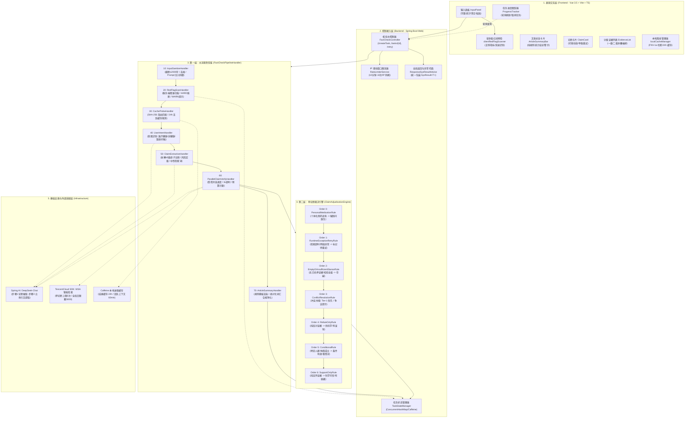
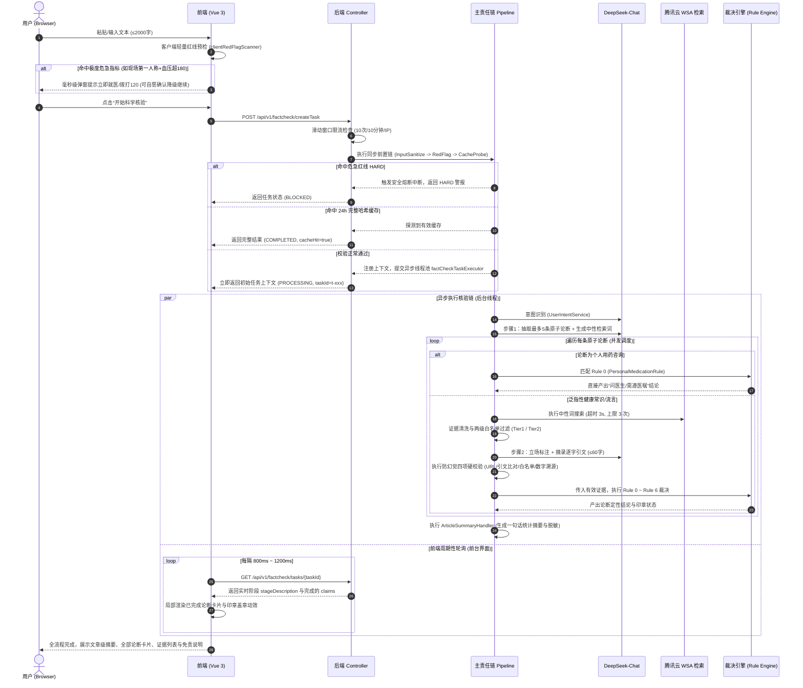
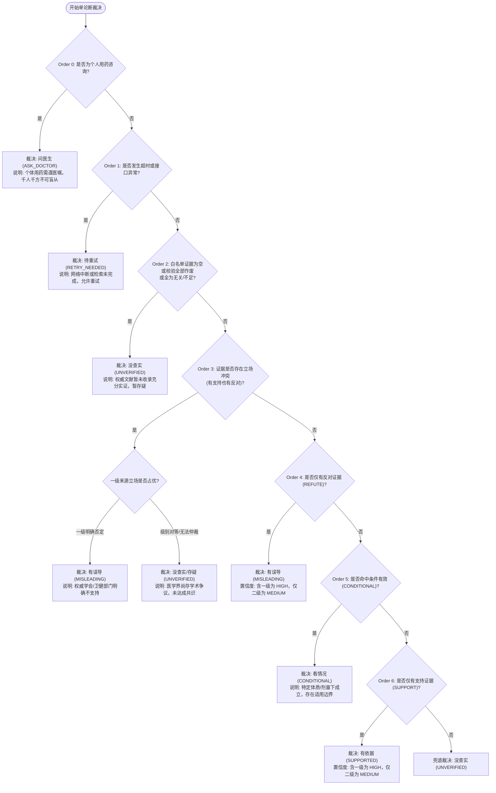

# 家医智核·流言粉碎 (FamilyDoc Sentinel)
> **面向家庭健康、长辈关怀与医疗常识的高置信度、可溯源事实核查系统**

[](https://openjdk.org/)
[](https://spring.io/projects/spring-boot)
[](https://spring.io/projects/spring-ai)
[](https://www.deepseek.com/)
[](https://cloud.tencent.com/)
[](https://vuejs.org/)
[](https://vitejs.dev/)
[](https://www.typescriptlang.org/)

---

## 目录

- [一、 项目背景与设计哲学](#一-项目背景与设计哲学)
  - [1.1 业务背景与行业痛点](#11-业务背景与行业痛点)
  - [1.2 五大核心设计哲学](#12-五大核心设计哲学)
- [二、 系统架构全景](#二-系统架构全景)
  - [2.1 分层架构全景图](#21-分层架构全景图)
  - [2.2 端到端核验时序与生命周期](#22-端到端核验时序与生命周期)
- [三、 双层责任链引擎深度解析](#三-双层责任链引擎深度解析)
  - [3.1 第一层：主流程编排责任链 (Pipeline)](#31-第一层主流程编排责任链-pipeline)
  - [3.2 第二层：单论断裁决决策树 (Adjudication Rules)](#32-第二层单论断裁决决策树-adjudication-rules)
- [四、 核心业务机制与算法实现](#四-核心业务机制与算法实现)
  - [4.1 危急红线双重扫描与熔断机制 (RedFlagService)](#41-危急红线双重扫描与熔断机制-redflagservice)
  - [4.2 反确认偏差的中性检索词生成 (Neutral Query)](#42-反确认偏差的中性检索词生成-neutral-query)
  - [4.3 权威证据两级白名单准入机制 (EvidenceAdmissionService)](#43-权威证据两级白名单准入机制-evidenceadmissionservice)
  - [4.4 证据立场标注与“四项硬校验”防幻觉体系 (StanceAnnotationService)](#44-证据立场标注与四项硬校验防幻觉体系-stanceannotationservice)
  - [4.5 文章级综合摘要纯规则模板生成 (ArticleSummaryGenerator)](#45-文章级综合摘要纯规则模板生成-articlesummarygenerator)
  - [4.6 医疗表述合规审查与绝对化用语脱敏](#46-医疗表述合规审查与绝对化用语脱敏)
- [五、 数据模型与业务枚举字典](#五-数据模型与业务枚举字典)
  - [5.1 核心枚举类详解](#51-核心枚举类详解)
  - [5.2 核心 DTO 实体结构](#52-核心-dto-实体结构)
- [六、 核心配置字典与环境变量清单](#六-核心配置字典与环境变量清单)
  - [6.1 外部凭证环境变量](#61-外部凭证环境变量)
  - [6.2 application.yaml 业务规则全量配置字典](#62-applicationyaml-业务规则全量配置字典)
- [七、 RESTful API 接口契约规范](#七-restful-api-接口契约规范)
  - [7.1 统一响应协议](#71-统一响应协议)
  - [7.2 接口详细规范与报文示例](#72-接口详细规范与报文示例)
- [八、 前端架构与交互状态机](#八-前端架构与交互状态机)
  - [8.1 组件拓扑结构](#81-组件拓扑结构)
  - [8.2 客户端毫秒级红线预检与本地指纹缓存](#82-客户端毫秒级红线预检与本地指纹缓存)
  - [8.3 异步轮询与动态印章动效机制](#83-异步轮询与动态印章动效机制)
- [九、 快速上手与本地部署指南](#九-快速上手与本地部署指南)
  - [9.1 基础环境准备](#91-基础环境准备)
  - [9.2 后端服务编译与运行](#92-后端服务编译与运行)
  - [9.3 前端工程安装与启动](#93-前端工程安装与启动)
  - [9.4 端到端功能测试与验证用例](#94-端到端功能测试与验证用例)
- [十、 生产排错与常见问题 (FAQ)](#十-生产排错与常见问题-faq)
- [十一、 项目文件拓扑结构](#十一-项目文件拓扑结构)

---

## 一、 项目背景与设计哲学

### 1.1 业务背景与行业痛点

在微信家庭群、朋友圈、自媒体平台中，中老年群体经常接触并转发大量“偏方秘方”、“食物相克”、“神医秘诀”以及“用药指导”类信息。这类健康流言呈现出以下显著特征：
1. **真伪掺杂**：部分流言在科学生活常识（如“多吃蔬菜对身体好”）的基础上夸大因果（如“每天一杯芹菜汁根治高血压，彻底停用降压药”）；
2. **高危害性**：鼓动慢性病患者擅自停药换药、宣称偏方急救突发心梗脑梗，极易导致不可逆的危急重症甚至威胁生命；
3. **传统通用大模型的问答缺陷**：
   - **大模型幻觉（Hallucination）**：模型可能基于概率生成看似权威却无医学出处的引用；
   - **确认偏差（Confirmation Bias）**：如果直接使用包含“辟谣”、“骗局”等倾向性词汇进行搜索，检索结果将被污染，丧失中立性；
   - **过度承诺与法律风险**：直接下达“100%正确”、“绝对保真”或以系统名义做官方背书，违背医疗信息合规规范。

**FamilyDoc Sentinel（家医智核·流言粉碎）** 绝不是一个简单的“AI 问答玩具”或“大模型套壳”，而是一套专为**循证事实核查**量身定制的工程化系统。

### 1.2 五大核心设计哲学

```
  ┌─────────────────────────────────────────────────────────────────┐
  │                   FamilyDoc Sentinel 五大基石                    │
  ├────────────────┬────────────────┬───────────────┬───────────────┤
  │  危急红线熔断  │  中性无偏检索  │ 严格白名单准入│ 防幻觉硬校验  │ 确定性规则裁决│
  │ (RedFlag First)│(Neutral Query) │(Tier-1/Tier-2)│(Hard Validity)│(Rule Engine)  │
  └────────────────┴────────────────┴───────────────┴───────────────┘
```

1. **危急红线绝对优先（RedFlag First）**：
   - 任何涉及突发高危症状（严重胸痛、大出血、昏迷）与危象生理指标（收缩压 $\ge 180\,\text{mmHg}$，血糖 $\ge 16.7\,\text{mmol/L}$）的现场求助，系统**在调用任何外部检索与大模型前强行阻断**，弹窗督促立即拨打 120 急救电话。
2. **中性无偏检索（Neutral Query）**：
   - 提取检索词时必须剔除任何带有倾向性（如“辟谣”、“骗局”、“谣言”）与机构名（如“卫健委”、“丁香医生”）的词汇，以最客观的事实陈述（“核心实体 + 是否有效/有无科学依据”）向专业检索网关查询，保证论据全面可信。
3. **两级权威证据白名单（Strict Tier Whitelist）**：
   - 仅采信国家卫健委、疾控中心、药监局、WHO 等一级官方源，以及百强三甲医院、医科大学、权威科普媒体等二级源。商业广告、社交平台言论、未具名自媒体**一律剔除**。
4. **防幻觉四项硬校验（Hard Validity Checks）**：
   - 大模型在步骤 2 中**严禁调用自有外部参数记忆**，只能从检索摘要中一字不差地逐字摘录引文（$\le 60$ 字）；系统对大模型返回进行四项不可绕过的程序化硬校验，引文不匹配、数字编造或敏感词违规者直接作废。
5. **确定性规则裁决（Deterministic Rule Engine）**：
   - 大模型**绝不下最终结论**，只输出证据立场（支持/反对/条件成立/不足）；最终“有误导/有依据/看情况/没查实”完全由第二层规则责任链按严格数学逻辑计算得出，消除黑盒随机性。

---

## 二、 系统架构全景

### 2.1 分层架构全景图



### 2.2 端到端核验时序与生命周期



---

## 三、 双层责任链引擎深度解析

### 3.1 第一层：主流程编排责任链 (Pipeline)

所有主链路步骤均实现接口 [`FactCheckPipelineHandler`](file:///d:/projects/familydoc-sentinel/backend/src/main/java/cn/smallyoung/familydocsentinel/chain/pipeline/FactCheckPipelineHandler.java)，通过 Spring 的 `@Order` 注解严格编排：

```java
public interface FactCheckPipelineHandler {
    boolean handle(FactCheckContext context);
    default boolean isSynchronousPreCheck() { return false; }
}
```

| Order | 处理器类名 | 执行模式 | 职责与拦截条件 |
| :---: | :--- | :---: | :--- |
| **10** | `InputSanitizeHandler` | **同步** | 1. 拦截空文本与超过 2000 字符的超长文本；<br>2. 移除不可见控制字符、全角空白规整；<br>3. NFKC 文本归一化与 Prompt 注入粗筛（`INJECTION_PATTERN`）。 |
| **20** | `RedFlagScanHandler` | **同步** | 1. 调用 `RedFlagService` 进行服务端权威危急红线扫描；<br>2. 若命中 `HARD` 且请求中未携带 `ignoreHardRedFlag=true`，记录拦截警报并中断后续链路（返回 `false`）；<br>3. 命中 `WARN` 则打上黄色告警标签，流程继续放行。 |
| **30** | `CacheProbeHandler` | **同步** | 1. 检查请求是否携带 `skipCache=true`；<br>2. 计算输入全文 SHA-256 指纹；<br>3. 检索 Caffeine 缓存；若存在不包含“待重试”条目的完整结果，直接装载并中断后续执行（返回 `false`）。 |
| **40** | `UserIntentHandler` | **异步** | 1. 长度与注入二道检查；<br>2. 匹配常见寒暄/打招呼正则（`GREETING_PATTERN`）；<br>3. 调用 DeepSeek 模型执行 5 分类意图判定；非医疗或过于笼统时，中断并输出友好引导语。 |
| **50** | `ClaimExtractionHandler` | **异步** | 1. 调用模型步骤 1：抽取最多 5 条原子论断并划分分类（药物/疾病/生活方式）与风险（高/中/低）；<br>2. 提取不核验内容（`unverifiedItems`）；<br>3. 为论断生成中性检索词（`neutralQuery`），超长时调用语义压缩重写。 |
| **60** | `ParallelClaimVerifyHandler`| **异步** | 1. 依据并发配置（默认 3）在线程池中并行执行各论断核验；<br>2. 单条核验串联检索、白名单清洗、模型立场标注与第二层裁决；<br>3. 实时向上下文更新阶段进度与已完成卡片数。 |
| **70** | `ArticleSummaryHandler` | **异步** | 1. 基于已裁决论断的定性分布（有误导、有依据、看情况、没查实、问医生），调用规则模板生成文章级摘要；<br>2. 全文敏感词与绝对化用语扫描替换。 |

### 3.2 第二层：单论断裁决决策树 (Adjudication Rules)

单论断进入裁决时，由 [`ClaimAdjudicationEngine`](file:///d:/projects/familydoc-sentinel/backend/src/main/java/cn/smallyoung/familydocsentinel/chain/adjudication/ClaimAdjudicationEngine.java) 依次调用按 `@Order(0)` 到 `@Order(6)` 注入的规则。**首个返回 `true` 的规则直接定论并退出**：



---

## 四、 核心业务机制与算法实现

### 4.1 危急红线双重扫描与熔断机制 (RedFlagService)

系统严格遵循“**只拦截本人或家人此刻正在发生的危急重症，不拦截文章对急症救治方案的流言探讨**”的准则：

#### 判定矩阵

| 生理指标 / 症状词 | 伴随第一人称或家人称谓 | 伴随“当前/突发/救命”等现时线索 | 判定结果级别 (`Level`) | 业务处置行为 |
| :---: | :---: | :---: | :---: | :--- |
| **命中高危指标/急症** | **命中**（“我/我爸/老伴”） | **命中**（“正在/现在/刚突然/救命”） | **`HARD`（拦截级）** | 立即阻断一切后续处理，返回红色就医弹窗，要求拨打 120。 |
| **命中高危指标/急症** | 未命中（客观医学陈述） | 未命中（如“拍打手肘能救心梗”） | **`WARN`（提示级）** | 顶部亮起黄色提醒条，但放行后续核验，照常粉碎流言。 |
| **未命中指标/急症** | — | — | **`NONE`（正常）** | 正常进入后续处理。 |

#### 指标正则与单位自适应算法
1. **血压口语化兼容**：
   - 斜杠格式：`(?<![\d/.])(\d{2,3})\s*/\s*(\\d{2,3})(?![\d/.])`，防范 `2026/10/28` 日期误伤；
   - 口语格式：匹配“高压/收缩压 185”、“低压/舒张压 115”；
2. **血糖单位自动折算**：
   - 提取数字后，若数值 $> 33.3$（极少存在大于该数值的 $\text{mmol/L}$ 血糖），判定为欧美或部分仪器的 $\text{mg/dL}$ 单位，系统自动执行除以 $18.0$ 折算为国内标准的 $\text{mmol/L}$；
   - 阈值：高血糖 $\ge 16.7\,\text{mmol/L}$，低血糖 $\le 2.8\,\text{mmol/L}$；
3. **否定词回溯窗口**：
   - 症状词命中前，回溯匹配前 8 个字符（`NEGATION_LOOKBEHIND = 8`）；若出现“没有/未见/否认/并未”，自动消除误判。

### 4.2 反确认偏差的中性检索词生成 (Neutral Query)

为防止大模型或搜索引擎受带有主观偏见（如“XX是谣言吗”、“XX辟谣”）的诱导，系统在提取检索词时执行多级去偏与语义压缩：

1. **禁用词强制剥离**：
   - 检索词生成提示词严禁加入：“辟谣”、“谣言”、“骗局”、“假消息”、“真相”、“卫健委”、“丁香医生”等；
   - 统一格式模板：`[核心主谓宾] + [是否有效 / 有无科学依据 / 医学研究]`（例如：“喝醋软化血管有无科学依据”）。
2. **两阶段语义无损压缩**：
   - 检索词长度硬上限为 **50 字符**（提示词要求控制在 35 字以内）；
   - 超出 50 字符时，**严禁物理暴力截断**（会导致医学句意截断产生歧义），必须调用 `QUERY_COMPRESS_SYSTEM_PROMPT` 重写压缩（最多重写 2 次）；
   - 若 2 次重写后依然超限，判定该论断过于冗长复杂，转入不可核验清单（`UNVERIFIABLE_OR_VAGUE`），保障检索安全。

### 4.3 权威证据两级白名单准入机制 (EvidenceAdmissionService)

检索获得的海量网页，必须经由白名单准入过滤器严格洗炼：

```
                原始检索返回页面 (Raw WSA Pages)
                               │
               ┌───────────────┴───────────────┐
               ▼                               ▼
       [提取有效摘要文本]               [规范化链接去重]
       (Content / Passage)             (去掉跟踪参数/锚点)
               │                               │
               └───────────────┬───────────────┘
                               │
                               ▼
                    [白名单分级准入判定]
                     (classifySource)
                               │
        ┌──────────────────────┼──────────────────────┐
        ▼                      ▼                      ▼
  一级白名单 (Tier 1)    二级白名单 (Tier 2)     零级未命中 (Tier 0)
 (国家卫健/疾控/药监/WHO) (三甲医院/医科大/官媒/科普)   (论坛/自媒体/电商)
  权重系数: 1.5          权重系数: 1.2          【直接丢弃】
        │                      │               不入结论、不予展示
        └──────────────┬───────┘
                       ▼
              [同站同标题去重过滤]
                       ▼
            [排序分 = 相关度 × 等级系数]
                       ▼
               取 Top 4 送入模型步骤2
```

- **主流媒体健康报道标注**：命中华西都市报、人民网健康、新华网健康等媒体域名的，统一打上 `mediaReport = true` 标识，前端界面显著提示“媒体报道”以供辩证参考；
- **非白名单零级来源**：商业论坛、问答社区、自媒体号一律判定为 `TIER_0`，直接丢弃，严禁进入判定上下文。

### 4.4 证据立场标注与“四项硬校验”防幻觉体系 (StanceAnnotationService)

大模型调用中普遍存在篡改原文、自造数字的幻觉问题。本系统在调用 DeepSeek 输出立场时，引入严苛的程序化硬校验防线：

```
                      大模型输出 JSON 载荷
                               │
            ┌──────────────────┴──────────────────┐
            ▼                                     ▼
     [立场与引文列表]                       [转述说明文字]
     (annotations)                         (explanation)
            │                                     │
     ┌──────┴──────────────────────────────┐      │
     ▼                                     ▼      ▼
 校验 1: URL 存在性校验                校验 4: 说明数字溯源与合规脱敏
 (链接必须在本次 WSA 返回结果中)        (说明中出现的任何数字必须在已摘引文中找到;
     │                                敏感词强制替换)
 校验 2: 逐字引文比对校验                          │
 (引文必须在原摘要中逐字出现, ≤60字)                │
     │                                            │
 校验 3: 来源等级校验                             │
 (引文所属来源必须为 Tier 1 或 Tier 2)            │
     └──────────────────────┬─────────────────────┘
                            │
               全部通过? ───┴───► 任一条目不合格?
                  │                      │
                  ▼                      ▼
           纳入有效证据列表         作废该条证据立场
                                         │
                                 全部被作废? ── 是 ──► 标记 allInvalidatedByValidation=true
                                                        (直接落入没查实/引用未过校验)
```

1. **逐字完全比对**：去除两端及内部空白字符后，引文必须是候选证据摘要的真子串（`contains`），且长度 $\le 60$ 字，防止模型“艺术加工”；
2. **数字溯源检验**：使用正则 `\d+(?:\.\d+)?` 提取说明文字中的全部数字（包括血压值、比例百分比等），**每一个数字都必须在已通过校验的引文集合中存在**。若模型自创“有效率达95%”，程序立即判定违规并剔除。

### 4.5 文章级综合摘要纯规则模板生成 (ArticleSummaryGenerator)

全文核验完成后，由纯 Java 规则模板组装文章一句话结论，**严禁大模型生成文章级综述**，从根源上杜绝主观煽情词汇：
- **模板规则**：“共核验 $N$ 条说法：$X$ 条有误导，$Y$ 条有依据，$Z$ 条看情况，$W$ 条没查实”；
- **附加提示**：
  - 若未纳入核验数 $K > 0$，追加：“另有 $K$ 条未纳入核验”；
  - 若待重试条数 $R > 0$，追加：“$R$ 条暂时没查成，可点击重试”；
  - 若存在误导论断（$X \ge 1$），追加：“文中含与依据矛盾的说法，转发前请留意”；
  - 若存在用药咨询（$AskDoctor > 0$），追加：“文中有涉及个人用药的问题，请咨询医生或药师”。

### 4.6 医疗表述合规审查与绝对化用语脱敏

系统配置了全局字符串净化表，大模型生成的任何文字均自动流经该管道：

| 原始禁用/绝对化表述 | 规整替换后的中立表述 | 合规目的与法规背景 |
| :--- | :--- | :--- |
| `权威机构` / `权威专家` / `权威` | **可信来源** / **查证来源** | 消除盲目个人或机构崇拜，防范背书侵权 |
| `100%正确` / `100%准确` / `绝对属实` | **与证据相符** | 符合循证医学相对性与阶段性特征 |
| `名医背书` / `专家背书` / `官方背书` | **查证来源** | 防范虚假代言与违规广告宣传法风险 |
| `零风险` | **低风险** | 任何医疗或干预手段均不存在绝对零风险 |

---

## 五、 数据模型与业务枚举字典

### 5.1 核心枚举类详解

#### 1. `VerdictType` (论断最终裁决结论)
| 枚举项 | 编码 | 业务含义 | 适用印章色彩体系 |
| :--- | :--- | :--- | :--- |
| `MISLEADING` | `MISLEADING` | **有误导 / 伪科学** | 红色印章 (`#DC2626`) |
| `SUPPORTED` | `SUPPORTED` | **有依据 / 科学可信** | 绿色印章 (`#16A34A`) |
| `CONDITIONAL` | `CONDITIONAL`| **看情况 / 条件有效** | 琥珀色印章 (`#D97706`) |
| `UNVERIFIED` | `UNVERIFIED` | **没查实 / 证据不足** | 灰色印章 (`#6B7280`) |
| `ASK_DOCTOR` | `ASK_DOCTOR` | **问医生 / 需遵医嘱** | 蓝色印章 (`#2563EB`) |
| `RETRY_NEEDED`| `RETRY_NEEDED`| **待重试 / 接口超时** | 橙色印章 (`#EA580C`) |

#### 2. `TaskStage` (核验任务主流程阶段)
| 阶段编码 | 对应前端展示提示 | 所属执行模式 |
| :--- | :--- | :---: |
| `SANITIZING` | 正在检查与整理输入内容... | 同步 |
| `RED_FLAG_SCANNING`| 正在扫描突发重症与高危信号... | 同步 |
| `CACHE_PROBING` | 正在检索历史核验记录... | 同步 |
| `INTENT_ANALYZING`| 正在分析问题意图... | 异步 |
| `CLAIM_EXTRACTING`| 正在拆解文章中的核心说法... | 异步 |
| `PARALLEL_VERIFYING`| 正在多路查证权威证据并判定... | 异步 |
| `SUMMARY_GENERATING`| 正在生成综合核验结论... | 异步 |
| `FINISHED` | 核验完成 | 终端态 |

#### 3. `SourceTier` (证据来源等级)
- `TIER_1`（一级来源）：国家卫健委、中国疾控中心、国家药监局、WHO、中华医学会等，排序加权系数 **1.5**；
- `TIER_2`（二级来源）：百强三甲医院、医科大学官网、主流官方媒体健康频道、专业医学科普平台，排序加权系数 **1.2**；
- `TIER_0`（未准入）：商业论坛、社交平台、未认证自媒体，**不准入并丢弃**。

#### 4. `UnverifiedReason` (未纳入核验原因)
- `IRRELEVANT_OR_SUBJECTIVE`：与健康无关或纯属个人主观感受；
- `NAMED_PRODUCT_PROMOTION`：具名商业品牌或具体保健品推销；
- `UNVERIFIABLE_OR_VAGUE`：过于笼统或无法通过现有医学证据验证；
- `EXCEED_MAX_CLAIMS`：超出单次任务 5 条论断上限而沉淀至折叠清单。

### 5.2 核心 DTO 实体结构

- **`FactCheckTaskResponse`**：任务聚合响应对象，承载 `taskId`、`stage`、`progressPercent`、`claims`、`unverifiedItems`、`redFlag` 以及常驻免责声明。
- **`ClaimItemDto`**：单条论断模型，承载 `claimId`、`originalText`、`verdict`、`confidence`、`neutralQuery`、`explanation`、`riskAlert`、`evidences` 及 `retryable` 重试标记。
- **`EvidenceItemDto`**：循证证据条目，承载 `title`、`url`、`sourceDomain`、`publisher`、`sourceTier`、`stance`（SUPPORT/REFUTE/CONDITIONAL）及 `quoteText`（逐字引文）。

---

## 六、 核心配置字典与环境变量清单

### 6.1 外部凭证环境变量

| 变量名称 | 必须 | 作用与示例 |
| :--- | :---: | :--- |
| `DEEPSEEK_API_KEY` | **是** | DeepSeek 开放平台 API Key（例如：`sk-xxxxxxxx`） |
| `DEEPSEEK_MODEL` | 否 | 模型名称，缺省为 `deepseek-chat` |
| `TENCENT_WSA_SECRET_ID` | **是** | 腾讯云 API 访问 SecretId，需开通智能搜索服务权限 |
| `TENCENT_WSA_SECRET_KEY` | **是** | 腾讯云 API 访问 SecretKey |

### 6.2 application.yaml 业务规则全量配置字典

```yaml
server:
  port: 8080
  forward-headers-strategy: native

spring:
  application:
    name: familydoc-sentinel
  ai:
    deepseek:
      api-key: ${DEEPSEEK_API_KEY:}
      chat:
        model: ${DEEPSEEK_MODEL:deepseek-chat}

tencentcloud:
  wsa:
    secretId: ${TENCENT_WSA_SECRET_ID:}
    secretKey: ${TENCENT_WSA_SECRET_KEY:}

factcheck:
  search:
    max-per-claim: 3             # 单论断最多允许发起的联网检索次数（含升级检索）
    max-per-request: 12          # 单次核验任务消耗检索总预算硬上限
    daily-quota: 5000            # 服务端单日检索全局调用配额硬上限
    quota-warn-ratio: 0.8        # 配额水位达 80% 触发运维预警日志
    relevance-threshold: 0.5     # 证据准入相关度阈值
    query-max-length: 50         # 中性检索词最大字符数（超限调用模型语义压缩）
    timeout-seconds: 3           # 单次 HTTP 检索网络请求超时时间 (秒)
    claim-timeout-seconds: 12    # 单条论断全流程处理硬超时 (秒)
    task-timeout-seconds: 30     # 整次任务全流程处理硬超时 (秒)
    concurrency: 3               # 论断并发核验线程并发度
    enable-academic: false       # 是否开启学术深度检索扩展

  cache:
    active-task-ttl-minutes: 60  # 活跃任务上下文内存存活时长
    result-cache-ttl-hours: 24   # 完整无失败核验结论的高频缓存时长

  red-flag:
    sbp-threshold: 180           # 收缩压危象阈值 (mmHg)
    dbp-threshold: 110           # 舒张压危象阈值 (mmHg)
    glucose-high-threshold: 16.7 # 高血糖危急阈值 (mmol/L)
    glucose-low-threshold: 2.8   # 低血糖危急阈值 (mmol/L)

  whitelist:
    tier1-domains:               # 一级域名后缀白名单（中央及各省市卫健委、疾控、药监局、WHO等）
      - nhc.gov.cn
      - chinacdc.cn
      - cdc.gov.cn
      - nmpa.gov.cn
      - who.int
      - cma.org.cn
    tier1-site-keywords:         # 一级机构名称关键词（须伴随 .gov.cn/.org.cn/.edu.cn 非商业域名）
      - 卫生健康委
      - 疾病预防控制中心
      - 药品监督管理局
      - 中华医学会
    tier2-hospital-domains:      # 二级三甲重点医院与顶级医科大官网域名
      - pumch.cn
      - wchscu.cn
      - zs-hospital.sh.cn
      - rjh.com.cn
      - huashan.org.cn
    tier2-media-domains:         # 二级主流官方媒体健康频道
      - health.people.com.cn
      - xinhuanet.com
      - cctv.com
      - thepaper.cn
    tier2-science-domains:       # 二级专业可信科普机构
      - dxy.cn
      - guokr.com
      - kepuchina.cn
      - msdmanuals.cn

  compliance:
    query-forbidden-words:       # 检索词禁用词表（防止引导偏见）
      - 辟谣
      - 谣言
      - 骗局
      - 假消息
      - 卫健委
    explanation-forbidden-replacements: # 结论文本禁用词强制替换表
      "权威机构": "可信来源"
      "100%正确": "与证据相符"
      "名医背书": "查证来源"
      "零风险": "低风险"
```

---

## 七、 RESTful API 接口契约规范

基础路径：`/api/v1/factcheck`

### 7.1 统一响应协议

所有 REST 接口均统一包装为 `SysResult<T>` 格式输出：
```json
{
  "code": 200,
  "message": "success",
  "data": { ... }
}
```

### 7.2 接口详细规范与报文示例

#### 接口 1：创建/提交流言核验任务

- **Method**: `POST`
- **Path**: `/api/v1/factcheck/createTask`（别名：`/tasks`）
- **Headers**: `Content-Type: application/json`
- **Request Body**:
  ```json
  {
    "text": "每天喝一杯芹菜汁能根治高血压，彻底不用吃降压药了！我老伴高压190正难受呢，能吃这个吗？",
    "ignoreHardRedFlag": false,
    "skipCache": false
  }
  ```
- **Response Example (触发危急红线 HARD 熔断)**:
  ```json
  {
    "code": 200,
    "message": "success",
    "data": {
      "taskId": "t-178239012398412",
      "status": "BLOCKED",
      "statusDescription": "核验任务已熔断阻断",
      "stage": "RED_FLAG_SCANNING",
      "stageDescription": "检测到危急重症高危信号，系统已启动安全熔断保护",
      "progressPercent": 100,
      "redFlag": {
        "level": "HARD",
        "category": "BLOOD_PRESSURE",
        "message": "检测到突发危急重症高危信号，请立即就近急诊就医或拨打 120 急救电话，切勿依赖网络自查！"
      },
      "claims": [],
      "unverifiedItems": [],
      "disclaimer": "比对信息仅供健康参考，不可作为处方或诊疗依据；内容由 AI 辅助生成，非官方结论。"
    }
  }
  ```

#### 接口 2：轮询查询任务实时进度与全量快照

- **Method**: `GET`
- **Path**: `/api/v1/factcheck/tasks/{taskId}`
- **Response Example (正常核验完成 COMPLETED 状态)**:
  ```json
  {
    "code": 200,
    "message": "success",
    "data": {
      "taskId": "t-178239012398412",
      "status": "COMPLETED",
      "statusDescription": "核验已全部完成",
      "stage": "FINISHED",
      "stageDescription": "核验完成",
      "progressPercent": 100,
      "completedClaimCount": 2,
      "totalClaimCount": 2,
      "queryHash": "e3b0c44298fc1c149afbf4c8996fb92427ae41e4649b934ca495991b7852b855",
      "cacheHit": false,
      "allowClientCache": true,
      "articleSummary": "共核验 2 条说法：1 条有误导，1 条看情况。文中含与依据矛盾的说法，转发前请留意。",
      "claims": [
        {
          "claimId": "c-1",
          "originalText": "每天喝一杯芹菜汁能根治高血压",
          "category": "DISEASE",
          "categoryName": "疾病与防治",
          "verdictCode": "MISLEADING",
          "verdictName": "有误导",
          "confidenceCode": "HIGH",
          "confidenceName": "高置信度",
          "explanation": "芹菜富含水分与微量元素，适量饮用对膳食均衡有益，但没有任何科学证据表明其能根治高血压；擅自停用降压药物存在严重的急性脑出血风险。",
          "riskAlert": "高血压病因复杂，需正规药物长效控制，切勿轻信食疗偏方导致病情恶化！",
          "retryable": false,
          "evidences": [
            {
              "evidenceId": "e-1",
              "title": "国家卫生健康委关于高血压科学防治健康指南",
              "url": "http://www.nhc.gov.cn/wjw/hygfyw/guideline.html",
              "sourceDomain": "nhc.gov.cn",
              "publisher": "国家卫生健康委",
              "sourceTier": "TIER_1",
              "sourceTierName": "一级来源",
              "stance": "REFUTE",
              "quoteText": "高血压患者必须在医师指导下规律服用降压药物，目前尚无任何食品或茶饮被证实能够根治高血压。"
            }
          ]
        }
      ],
      "unverifiedItems": [
        {
          "segmentText": "我觉得隔壁老王推荐的这个食疗方子挺神的",
          "reason": "IRRELEVANT_OR_SUBJECTIVE",
          "reasonDescription": "个人主观感受或闲聊，无法进行医学循证"
        }
      ],
      "disclaimer": "比对信息仅供健康参考，不可作为处方或诊疗依据；内容由 AI 辅助生成，非官方结论。",
      "privacyStatement": "本服务端不保存您的输入与核验结果；第三方服务遵循其各自条款"
    }
  }
  ```

#### 接口 3：取消正在进行中的核验任务

- **Method**: `POST`
- **Path**: `/api/v1/factcheck/tasks/{taskId}/cancel`
- **Response**: 返回状态置为 `CANCELLED` 的任务快照，后台正在执行的联网检索线程将安全中断。

#### 接口 4：单条论断单独重试 (US-07)

- **Method**: `POST`
- **Path**: `/api/v1/factcheck/tasks/{taskId}/claims/{claimId}/retry`
- **说明**: 针对某一论断因网络抖动判定为 `RETRY_NEEDED` 时，前端可只对其触发独立重试，不扰动整篇核验结果。

#### 接口 5：独立危急红线扫描

- **Method**: `POST`
- **Path**: `/api/v1/factcheck/redflag/scan`
- **Request Body**: 纯文本或包含 `text` 的 JSON，返回即时红线扫描结果 (`NONE`/`WARN`/`HARD`)。

---

## 八、 前端架构与交互状态机

前端工程基于 Vue 3 打造，针对中老年群体阅读习惯采用大号字体（18px+）、高对比度卡片与实体印章交互设计。

### 8.1 组件拓扑结构

```
frontend/src/
├── App.vue                         # 全局状态总控：协调轮询定时器、红线弹窗与历史抽屉
├── api/
│   └── factcheckApi.ts             # API 封装：支持创建、轮询、单条重试与取消
├── components/
│   ├── HeroBanner.vue              # 顶部产品名称展示、理念介绍及内置 4 组常见流言示例
│   ├── InputPanel.vue              # 文本输入域：支持字数实时统计、清除、粘贴及前置红线感知
│   ├── ProgressTracker.vue         # 动态进度条：展示多阶段阶段提示与进度百分比动画
│   ├── ArticleSummaryBar.vue       # 文章级总结条：展示统计性结论、整体倾向与健康风险警报
│   ├── ClaimCard.vue               # 单论断卡片：展示论断文本、分类、结论印章及重试按钮
│   ├── EvidenceList.vue            # 证据折叠抽屉：高亮一级/二级标签、逐字原文引文与外部出处跳转
│   ├── VerdictStamp.vue            # 印章动效组件：提供物理印章落款动画与颜色体系
│   ├── RedFlagAlert.vue            # 危机红线就医警告条：展示 120 急救指引
│   ├── ConsentModal.vue            # 免责同意与确认对话框：用于降级确认或首次使用确认
│   ├── UnverifiedCollapse.vue      # 不核验内容折叠面板：收纳主观言论、品牌广告与超额论断
│   └── LocalHistoryDrawer.vue      # 本地历史记录抽屉：可重载近期核验结果
├── types/
│   └── factcheck.ts                # TypeScript 统一接口契约模型
└── utils/
    ├── clientRedFlagScanner.ts     # 客户端毫秒级正则扫描器（输入防抖 300ms 触发）
    └── localCacheManager.ts        # FNV-1a 浏览器本地 24h 缓存管理器
```

### 8.2 客户端毫秒级红线预检与本地指纹缓存

1. **客户端快速前置预检 (`clientRedFlagScanner.ts`)**：
   - 用户在输入框中输入内容时，前端通过 300ms 防抖自动提取数值和症状词。
   - 若用户输入“我爸血压 210/120 昏迷了怎么办”，无需等待网络交互，界面即刻亮起红色急救提醒，避免耽误黄金就诊时间。
2. **本地客户端 24 小时缓存 (`localCacheManager.ts`)**：
   - 使用确定性 FNV-1a 双 32 位哈希算法对规范化文本计算指纹；
   - 本地 `localStorage` 缓存最多保留 30 条有效记录，超过 24 小时自动过期；
   - **严格防污染机制**：如果任务响应中包含任何“待重试”（`RETRY_NEEDED`）条目，`allowClientCache` 标记为 `false`，**绝不写入本地持久化缓存**，确保用户重试体验的正确性。

### 8.3 异步轮询与动态印章动效机制

- 用户提交任务后，前端进入轮询机制（间隔 800ms ~ 1200ms 向 `/tasks/{taskId}` 发送 GET 请求）；
- 后端采用增量同步方式，多论断并发核验时，先完成的论断会优先返回前端；
- 前端通过 `VerdictStamp.vue` 呈现盖章落款的 CSS 动画（缩放伴随轻微倾斜旋转动效），营造专业客观的公信力质感。

---

## 九、 快速上手与本地部署指南

### 9.1 基础环境准备

在开始本地部署前，请确认宿主机已安装如下基础环境：
- **Java SE Development Kit (JDK) 21**：运行 `java -version` 确认；
- **Apache Maven 3.9+**：运行 `mvn -version` 确认；
- **Node.js 18.18+ / 20.x** 以及 **npm** 或 **pnpm**：运行 `node -v` 确认。

### 9.2 后端服务编译与运行

1. 切换至后端工程根目录：
   ```bash
   cd d:/projects/familydoc-sentinel/backend
   ```
2. 设置必要环境变量（以 Windows PowerShell 为例）：
   ```powershell
   $env:DEEPSEEK_API_KEY="sk-your-deepseek-api-key"
   $env:TENCENT_WSA_SECRET_ID="your-tencent-secret-id"
   $env:TENCENT_WSA_SECRET_KEY="your-tencent-secret-key"
   ```
3. 编译工程并启动 Spring Boot 应用：
   ```powershell
   mvn clean spring-boot:run
   ```
4. 控制台输出如下日志表示启动成功：
   ```text
   Tomcat started on port 8080 (http) with context path '/'
   Started FamilydocSentinelApplication in 3.2 seconds
   ```

### 9.3 前端工程安装与启动

1. 打开新的终端，切换至前端目录：
   ```bash
   cd d:/projects/familydoc-sentinel/frontend
   ```
2. 安装项目依赖：
   ```bash
   npm install
   ```
3. 启动 Vite 开发调试服务器：
   ```bash
   npm run dev
   ```
4. 终端提示如下访问链接：
   ```text
   VITE v6.0.5 ready in 350 ms
   ➜  Local:   http://localhost:5173/
   ➜  Network: use --host to expose
   ```

### 9.4 端到端功能测试与验证用例

启动后在浏览器中打开 `http://localhost:5173` 进行全链路场景核验：

#### 测试用例 1：经典健康伪科学（验证检索与裁决）
- **输入文本**：“每天早起空腹喝一杯热醋，不仅能软化血管，还能彻底治愈高血脂，完全不用再吃他汀类药物。”
- **预期反应**：
  1. 拆解出 2 条论断（“喝醋软化血管治愈高血脂”与“完全不用再吃他汀”）；
  2. 检索词中不包含“辟谣/谣言”字眼；
  3. 最终分别盖上 **【有误导】** 印章，并附带心血管学会指南等权威一级证据及停药心脑血管风险提示。

#### 测试用例 2：危急重症高危熔断（验证安全红线）
- **输入文本**：“我刚才测了血压高压200低压125，胸口痛得大汗淋漓，吃安宫牛黄丸能救命吗？”
- **预期反应**：
  1. 前端输入过程中即时亮起危急重症弹窗；
  2. 即使提交后端，也会被 `RedFlagScanHandler` 瞬间熔断中断，返回红色就医警报，不会浪费任何外部检索额度。

#### 测试用例 3：个人用药咨询（验证 Rule 0 零检索）
- **输入文本**：“我最近刚查出来高血压，医生开的氨氯地平我每天吃两片有点头晕，能不能自己改成吃半片？”
- **预期反应**：
  1. 识别为个体化用药咨询（`personalMedication=true`）；
  2. 直接走 Rule 0 裁决为 **【问医生】** 结论，提示个体用药千人千方，绝不盲目进行网络检索。

---

## 十、 生产排错与常见问题 (FAQ)

### Q1: 启动时报错 `DEEPSEEK_API_KEY` 为空或调用返回 401？
- **排查方法**：检查运行环境是否已正确设置环境变量 `DEEPSEEK_API_KEY`。在本地排查时，也可在 `backend/src/main/resources/application.yaml` 中配置默认测试密钥。

### Q2: 检索返回为空，所有论断均落入“没查实”？
- **排查方法**：
  1. 检查腾讯云 `TENCENT_WSA_SECRET_ID` 与 `SECRET_KEY` 是否有效并已开通 WSA 智能搜索调用权限；
  2. 检查当日是否超过了 `daily-quota`（默认 5000 次限制）或单任务并发预算。

### Q3: 前端提示“操作太频繁，请稍后再试”？
- **排查方法**：触发了 `RateLimiterService` 的单 IP 滑动窗口限流防刷机制（默认 10 分钟最多 10 次）。可在测试环境下于 `RateLimiterService.java` 中临时调宽阈值。

### Q4: 前端无法连通后端接口或报 404 / 502？
- **排查方法**：检查 `frontend/vite.config.ts` 中的 `proxy` 转发配置，确认后端服务是否在 `http://localhost:8080` 正常运行。

---

## 十一、 项目文件拓扑结构

```
familydoc-sentinel/
├── README.md                                  # 项目全栈总说明文档 (本文件)
├── backend/                                   # 后端工程 (Spring Boot 4.x + Java 21)
│   ├── pom.xml                                # Maven 依赖与构建配置
│   └── src/
│       ├── main/
│       │   ├── java/cn/smallyoung/familydocsentinel/
│       │   │   ├── FamilydocSentinelApplication.java # Spring Boot 启动主类
│       │   │   ├── chain/
│       │   │   │   ├── adjudication/          # 第二层：单论断规则裁决责任链
│       │   │   │   │   ├── AdjudicationSupport.java          # 裁决公用辅助工具
│       │   │   │   │   ├── ClaimAdjudicationContext.java     # 裁决上下文数据载荷
│       │   │   │   │   ├── ClaimAdjudicationEngine.java      # 裁决链调度执行引擎
│       │   │   │   │   ├── ClaimAdjudicationRule.java        # 裁决规则基础契约接口
│       │   │   │   │   ├── PersonalMedicationRule.java       # Order 0: 个体用药问医生
│       │   │   │   │   ├── RuntimeExceptionRetryRule.java    # Order 1: 异常待重试
│       │   │   │   │   ├── EmptyOrInsufficientStanceRule.java# Order 2: 证据不足存疑
│       │   │   │   │   ├── ConflictResolutionRule.java       # Order 3: 循证冲突仲裁
│       │   │   │   │   ├── RefuteOnlyRule.java               # Order 4: 仅反对裁定有误导
│       │   │   │   │   ├── ConditionalRule.java              # Order 5: 条件有效看情况
│       │   │   │   │   └── SupportOnlyRule.java              # Order 6: 仅支持裁定有依据
│       │   │   │   └── pipeline/              # 第一层：主流程编排责任链
│       │   │   │       ├── FactCheckPipelineHandler.java     # 主链路节点抽象接口
│       │   │   │       ├── FactCheckContext.java             # 全局任务状态上下文
│       │   │   │       ├── InputSanitizeHandler.java         # Order 10: 输入清洗校验
│       │   │   │       ├── RedFlagScanHandler.java           # Order 20: 危急红线扫描
│       │   │   │       ├── CacheProbeHandler.java            # Order 30: 缓存探测
│       │   │   │       ├── UserIntentHandler.java            # Order 40: 用户意图过滤
│       │   │   │       ├── ClaimExtractionHandler.java       # Order 50: 论断拆解分流
│       │   │   │       ├── ParallelClaimVerifyHandler.java   # Order 60: 并发多路核验
│       │   │   │       └── ArticleSummaryHandler.java        # Order 70: 综合摘要生成
│       │   │   ├── component/
│       │   │   │   └── ResponseSysResultAdvice.java          # 全局统一响应与异常拦截
│       │   │   ├── config/
│       │   │   │   ├── AiClientConfig.java                   # Spring AI 客户端配置
│       │   │   │   ├── AsyncConfig.java                      # 异步线程池与并发配置
│       │   │   │   ├── FactCheckProperties.java              # 核心业务策略配置映射类
│       │   │   │   └── WsaClientConfig.java                  # 腾讯云 WSA 客户端配置
│       │   │   ├── controller/
│       │   │   │   └── FactCheckController.java              # 核心 RESTful 控制器
│       │   │   ├── dto/                                      # 数据传输对象定义
│       │   │   │   ├── ClaimItemDto.java                     # 论断实体模型
│       │   │   │   ├── EvidenceItemDto.java                  # 证据实体模型
│       │   │   │   ├── FactCheckRequest.java                 # 核验请求模型
│       │   │   │   ├── FactCheckTaskResponse.java            # 任务聚合响应模型
│       │   │   │   ├── IntentAnalysisResult.java             # 意图分析模型
│       │   │   │   ├── RedFlagResult.java                    # 危急红线扫描模型
│       │   │   │   ├── StampDto.java                         # 判决印章动效模型
│       │   │   │   ├── UnverifiedItemDto.java                # 不核验内容模型
│       │   │   │   └── WsaSearchPage.java                    # 原始检索结果模型
│       │   │   ├── enums/                                    # 业务状态与定性枚举
│       │   │   │   ├── ClaimCategory.java                    # 论断领域分类
│       │   │   │   ├── ClaimVerifyStage.java                 # 论断核验子阶段
│       │   │   │   ├── ConfidenceLevel.java                  # 结论置信度级别
│       │   │   │   ├── RiskLevel.java                        # 误导风险等级
│       │   │   │   ├── SourceTier.java                       # 证据来源级别
│       │   │   │   ├── StanceType.java                       # 证据对论断的立场
│       │   │   │   ├── TaskStage.java                        # 主流程阶段枚举
│       │   │   │   ├── TaskStatus.java                       # 任务全局状态枚举
│       │   │   │   ├── UnverifiedCause.java                  # 没查实归因
│       │   │   │   ├── UnverifiedReason.java                 # 未纳入核验原因
│       │   │   │   └── VerdictType.java                      # 最终裁决结果定性
│       │   │   ├── exception/
│       │   │   │   └── BizException.java                     # 统一业务异常封装
│       │   │   ├── interfaces/
│       │   │   │   └── ResponseSysResult.java                # 控制器自动封装标记注解
│       │   │   ├── service/                                  # 核心业务实现服务
│       │   │   │   ├── ArticleSummaryGenerator.java          # 文章级纯规则模板生成器
│       │   │   │   ├── ClaimExtractionService.java           # 步骤1: 论断抽取分流与检索词
│       │   │   │   ├── ContentSanitizerService.java          # 文本基础去噪规整服务
│       │   │   │   ├── EvidenceAdmissionService.java         # 证据清洗去重与白名单准入
│       │   │   │   ├── FactCheckService.java                 # 责任链调度与任务入口
│       │   │   │   ├── RateLimiterService.java               # IP 滑动窗口限流器
│       │   │   │   ├── RedFlagService.java                   # 服务端精准危急红线扫描
│       │   │   │   ├── SingleClaimVerifyService.java         # 单论断核验闭环与重试服务
│       │   │   │   ├── StanceAnnotationService.java          # 步骤2: 立场标注与四项硬校验
│       │   │   │   ├── TaskStateManager.java                 # 任务上下文状态机管理器
│       │   │   │   ├── UserIntentService.java                # 意图前置分类器服务
│       │   │   │   └── WsaSearchService.java                 # 腾讯云 WSA 检索调度服务
│       │   │   └── utils/
│       │   │       ├── RequestUtils.java                     # 客户端真实 IP 提取工具
│       │   │       └── SysResult.java                        # 统一 API 响应包装实体
│       │   └── resources/
│       │       └── application.yaml                          # 核心策略、限额与白名单配置
│       └── test/                                             # 单元测试用例
└── frontend/                                                 # 前端工程 (Vue 3 + Vite + TypeScript)
    ├── package.json                                          # 前端依赖配置
    ├── tsconfig.json                                         # TypeScript 编译配置
    ├── vite.config.ts                                        # Vite 配置与后端反向代理
    └── src/
        ├── App.vue                                           # 主视图界面与状态机总控
        ├── main.ts                                           # Vue 实例挂载入口
        ├── env.d.ts                                          # 环境变量与模块类型声明
        ├── api/
        │   └── factcheckApi.ts                               # 异步 API 通信与轮询驱动
        ├── components/                                       # 业务呈现组件库
        │   ├── ArticleSummaryBar.vue                         # 综合结论卡片
        │   ├── ClaimCard.vue                                 # 逐条论断定性卡片
        │   ├── ConsentModal.vue                              # 免责与红线知情弹窗
        │   ├── EvidenceList.vue                              # 权威证据分级折叠抽屉
        │   ├── HeroBanner.vue                                # 顶部横幅与快捷示例
        │   ├── InputPanel.vue                                # 文本输入区与前置红线感知
        │   ├── LocalHistoryDrawer.vue                        # 24h 本地历史抽屉
        │   ├── ProgressTracker.vue                           # 阶段进度条
        │   ├── RedFlagAlert.vue                              # 危急红线急救横幅
        │   ├── UnverifiedCollapse.vue                        # 不可核验内容折叠列表
        │   └── VerdictStamp.vue                              # 裁决印章物理落款动效
        ├── styles/
        │   └── main.css                                      # 大号无障碍适老色彩样式
        ├── types/
        │   └── factcheck.ts                                  # 前端强类型契约与接口模型
        └── utils/
            ├── clientRedFlagScanner.ts                       # 客户端毫秒级红线扫描工具
            └── localCacheManager.ts                          # 浏览器本地 24h 缓存管理器
```
